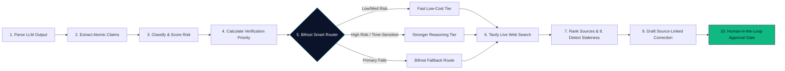
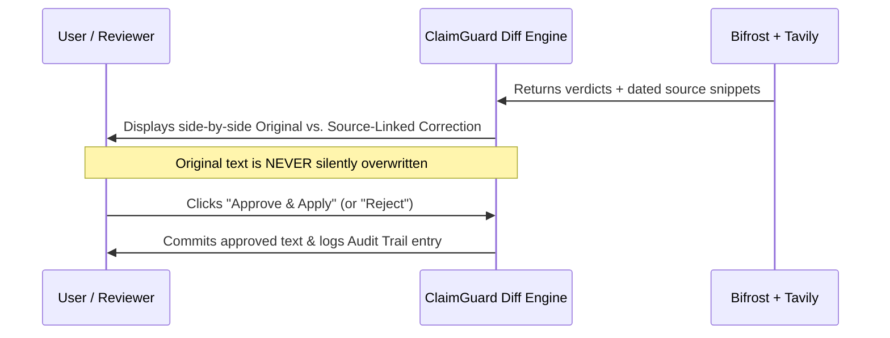

# 🛡️ ClaimGuard

**Token-Efficient, Source-Grounded Verification & Auto-Correction Layer for AI Agents**

[](https://claimguard.vercel.app) [](https://tavily.com) [](https://getmaxim.ai) [](#11-license)

> *“ClaimGuard turns uncertain AI answers into evidence-backed, source-linked, human-approved answers.”*

---

## 1. Hackathon Track & Submission Overview

- **Event:** Global AI Hackathon on HackCulture
- **Primary Theme:** Stale-Answer Detector for LLM Outputs (**Tavily**)
- **Secondary Theme:** Token-Efficient Coding Agent / Gateway Observability (**Bifrost by Maxim AI**)
- **Live Demo:** *(Add your Vercel URL here)*
- **Repository:** *(Add your GitHub repo URL here)*

---

## 2. The Problem

1. **Temporal Drift & Hallucinations:** AI agents sound 100% confident even when outputting outdated exchange rates, retired SDKs, changed fees, or unsupported claims.
2. **Prohibitive Verification Cost:** Re-verifying every sentence with an expensive frontier model is too slow and costly to scale in production.
3. **Silent Overwrites Break Trust:** Users need to see *which* claims failed, *what* live source contradicted them, and explicitly approve every edit before it is applied.

---

## 3. 10-Step Agentic Verification Pipeline



---

## 4. Deep Partner Technology Integration

### Tavily — Live Evidence & Staleness Engine
- Executes targeted web searches per extracted claim (`basic` depth for routine checks, `advanced` depth for high-risk/time-sensitive claims).
- Extracts **Source Title**, **Clickable URL**, **Publication Date**, and **Verbatim Evidence Snippets**.
- Ranks sources by recency and detects **stale** or **contradicted** claims without ever fabricating citations.

### Bifrost by Maxim AI — Intelligent Routing & Cost Observability
- **Tiered Model Routing:** Routes routine factual/historical claims to a fast, low-cost model and escalates time-sensitive, financial, or legal claims to a stronger reasoning model.
- **Automatic Fallback Routing:** Seamlessly switches to a backup model on timeout or failure and logs every fallback event in the UI.
- **Telemetry & Budget Caps:** Tracks per-claim tokens, latency (ms), cost ($ USD), cache hits, and monthly workspace budget limits.

---

## 5. Non-Negotiable Verification Taxonomy

ClaimGuard **never** presents an unverified claim as verified. Every claim receives one of five strict verdicts:

| Verdict | Color | Meaning & Rule |
| :--- | :---: | :--- |
| **`SUPPORTED`** | 🟢 Green | Directly backed by retrieved, dated web evidence |
| **`PARTIALLY SUPPORTED`** | 🟡 Amber | Core assertion aligns, but qualifiers or scope need nuance |
| **`STALE`** | 🟡 Amber | Was true historically, but superseded by newer live sources |
| **`CONTRADICTED`** | 🔴 Red | Directly refuted by current authoritative evidence |
| **`UNVERIFIABLE`** | ⚪ Grey | Insufficient reliable evidence found; never guessed |

Every verdict card surfaces: **Original Claim • Source Title • Source URL • Publication Date • Evidence Snippet • Confidence Score • Reasoning Summary**.

---

## 6. Human-in-the-Loop (HITL) Approval Flow



---

## 7. Official 4-Claim Demo Walkthrough

Click **"Load Official Demo"** in `/verify` to test this exact multi-domain response:

> *“India’s handloom sector employs over 35 lakh people. The latest ONDC seller fee is 2%. Gadwal sarees received GI recognition in 2010. The Indian rupee is currently trading at ₹75 per US dollar.”*

1. **Extracts & Classifies 4 Claims:** Separates `Statistical`, `Financial / Time-sensitive`, and `Historical` claims.
2. **Bifrost Tiered Routing:** Sends historical/statistical checks to the fast tier and routes the live ONDC fee & INR/USD exchange rate to the stronger reasoning tier (with fallback telemetry).
3. **Tavily Verification:** Flags the **₹75/USD** rupee claim as **`STALE` / `CONTRADICTED`** using current FX evidence and grounds verifiable claims with clickable citations (or marks missing evidence `UNVERIFIABLE`).
4. **HITL Diff & Export:** Generates a source-linked corrected answer, awaits human approval, and exports a full JSON/Markdown Verification Audit Report.

---

## 8. Tech Stack & Screens

- **Framework:** Next.js (App Router) + TypeScript + Tailwind CSS + shadcn/ui
- **State & Visuals:** Zustand (`localStorage` history), Framer Motion (10-step agent timeline), Recharts (token/cost/latency charts), Lucide Icons
- **Core Screens:** Landing (`/`), Verification Workspace (`/verify`), Bifrost Observability (`/observability`), Batch Verification (`/batch`), Audit History (`/history`), 3-Minute Judge Walkthrough (`/demo`), API & Budget Settings (`/settings`)

---

## 9. Local Setup & Vercel Deployment

```bash
# 1. Clone your repository
git clone https://github.com/<your-username>/claimguard.git
cd claimguard

# 2. Install dependencies
npm install

# 3. Configure environment variables
cp .env.example .env.local
# Add TAVILY_API_KEY and BIFROST_API_KEY (optional: runs in [SIMULATED] mode without keys)

# 4. Run locally
npm run dev
```

To deploy on **Vercel**, import the GitHub repository and add `TAVILY_API_KEY` and `BIFROST_API_KEY` under **Project Settings → Environment Variables**.

---

## 10. `[SIMULATED]` API Disclosure

- **Live Mode:** When `TAVILY_API_KEY` and `BIFROST_API_KEY` are configured, ClaimGuard executes real-time Tavily web searches and Bifrost gateway routing.
- **Simulated Mode:** Whenever an API key is absent, ClaimGuard runs deterministic mock adapters with realistic latency, retry, and fallback simulations—and **explicitly badges every mock output and telemetry metric as `[SIMULATED]`**.

---

## 11. License

This project is licensed under the **MIT License**.
