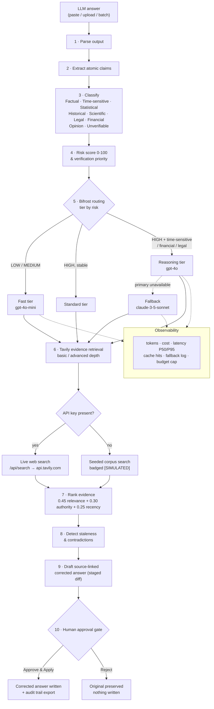

# ClaimGuard

**Token-efficient, source-grounded verification & auto-correction layer for AI agents.**

> ClaimGuard turns uncertain AI answers into evidence-backed, source-linked, human-approved answers.

Built for the **Global AI Hackathon on HackCulture**
· Primary theme: *Stale-Answer Detector for LLM Outputs* (**Tavily**)
· Secondary theme: *Token-Efficient Coding Agent / Open-Source Bifrost Gateway Extension* (**Bifrost by Maxim AI**)

---

## The problem it solves

An LLM answer is a wall of confident prose. Some of it is true, some of it was
true six months ago, and some of it was never true. A reviewer cannot check it
at the speed the agent produces it.

ClaimGuard decomposes the answer into atomic claims and gives each one a
verdict, a real citation, a confidence score, and a staged correction — then
stops and waits for a human.

## Non-negotiable guardrails

These are enforced structurally, not by prompt instruction.

| # | Guardrail | Where it is enforced |
|---|---|---|
| 1 | Never present an unverified claim as verified | `evaluateClaim` returns `UNVERIFIABLE` on an empty evidence set — `src/lib/engine/evaluate.ts` |
| 2 | Strict 5-verdict taxonomy | `VERDICTS` is a closed union type; `parseVerdictJson` rejects any out-of-taxonomy verdict from a live model |
| 3 | Mandatory verdict schema on every card | `ClaimCard` renders `originalClaim`, `evidenceSourceTitle`, `sourceUrl`, `publicationDate`, `evidenceSnippet`, `confidenceScore`, `reasoningSummary` — `src/components/claim-card.tsx` |
| 4 | Immutable original text | `buildCorrectedText` derives a *new* string; `run.originalText` is never assigned after creation — `src/lib/corrected-text.ts` |
| 5 | Mandatory human-in-the-loop gate | `applyCorrections` is the only writer of `run.correctedText` and requires ≥1 approved claim — `src/lib/store.ts` |
| 6 | Honest mock labelling | Every simulated response carries `mode: "simulated"` and renders `[SIMULATED]` in the timeline, cards, drawer, dashboard and exports |
| 7 | Zero fabricated citations | Simulated retrieval can only return documents that exist in `CORPUS`; a claim with no match gets no evidence and no citation |

### The 5 verdicts

| Verdict | Colour | Meaning |
|---|---|---|
| `SUPPORTED` | Green | Retrieved evidence agrees with the claim within tolerance |
| `PARTIALLY SUPPORTED` | Amber | Evidence backs part of the claim, or the claim over-generalises a narrower fact |
| `STALE` | Amber | The claim was once true but newer dated evidence supersedes it |
| `CONTRADICTED` | Red | Current evidence directly disagrees beyond tolerance |
| `UNVERIFIABLE` | Slate | No reliable evidence retrieved. No citation is invented |

---

## Architecture



### Partner integrations

**Tavily** — `src/lib/adapters/tavily.ts`
Per-claim live web search (`basic` depth for low-risk claims, `advanced` for
high-risk and time-sensitive ones), extracting title, URL, publication date and
a verbatim snippet. Sources are ranked on
`0.45 × relevance + 0.30 × authority + 0.25 × recency`; undated sources score
35 on recency because recency cannot be established. Staleness is detected by
comparing the claim's own number against the newest dated evidence.

**Bifrost by Maxim AI** — `src/lib/adapters/bifrost.ts`
An OpenAI-compatible gateway client (`<baseUrl>/chat/completions`) with
configurable base URL, key and monthly USD budget cap. Tiered routing sends
low-risk claims to a cheap model and escalates time-sensitive, financial and
legal claims to a frontier reasoning model. When the primary model errors or
times out the call re-routes to a fallback model and a **Bifrost Fallback
Event** is logged. A semantic cache plus per-claim accounting records tokens,
latency, cost and cache hits; the budget cap is enforced, not advisory — once
it is hit, calls stop and affected claims become `UNVERIFIABLE` rather than
silently degrading.

Both adapters resolve in the same order: **server-side key → browser key →
simulated**. Add keys and the identical pipeline runs live; no code changes.

---

## The `[SIMULATED]` disclosure

With no API key, ClaimGuard does not fake being live. It runs a realistic mock
flow — simulated latency, deterministic results, staged events — and badges
every simulated response `[SIMULATED]` in the agent timeline, on claim cards,
in the evidence drawer, in Observability and in every export.

Simulated evidence is **not invented**. It comes from a real corpus of
documents (`src/lib/seed.ts`) that were actually retrieved and read on
**2026-11-20**; the titles, URLs, publication dates and snippets are verbatim
from those pages. A claim with no match in that corpus gets **no** evidence and
becomes `UNVERIFIABLE` — the seeded corpus can never stretch to cover a claim
it does not contain.

---

## The official 4-claim demo

One click — **Load Official Hackathon Demo** — populates:

> “India's handloom sector employs over 35 lakh people. The latest ONDC seller
> fee is 2%. Gadwal sarees received GI recognition in 2010. The Indian rupee
> is currently trading at ₹75 per US dollar.”

| # | Claim | Type | Risk | Tier | Verdict |
|---|---|---|---|---|---|
| 1 | Handloom sector employs over 35 lakh | Statistical | 31 | Fast | **SUPPORTED** |
| 2 | Latest ONDC seller fee is 2% | Financial · time-sensitive | 74 | Reasoning ↩ | **PARTIALLY SUPPORTED** |
| 3 | Gadwal sarees got GI recognition in 2010 | Historical | 24 | Fast | **SUPPORTED** |
| 4 | Rupee currently trading at ₹75/USD | Financial · time-sensitive | 95 | Reasoning | **CONTRADICTED** |

↩ = surfaces a visible Bifrost fallback event (`gpt-4o` → `claude-3-5-sonnet`).

Why those verdicts:

1. **Supported** — the Fourth All India Handloom Census (2019-20) records
   26,73,891 weavers + 8,48,621 allied workers = 35.22 lakh, so "over 35 lakh"
   holds.
2. **Partially supported** — there is no single network-level ONDC seller fee.
   Retrieved 2026 sources agree the network takes zero commission; the charge a
   seller actually pays is a *seller-app* fee running 1% to 5%+ (Kaarobari 2%,
   Vikra 1%, Mystore 2–5%, Fynd 3%). The 2% figure is real but belongs to one
   seller app.
3. **Supported** — the Development Commissioner for Handlooms register lists
   Gadwal Sarees with GI certificate date 04.08.2010 (Application No. 137,
   Certificate No. 124).
4. **Contradicted** — current mid-market quotations put USD/INR at
   ₹92.62–₹93.47, with a 52-week range of ₹85.86–₹97.05. The claimed ₹75 sits
   below the entire observed range.

---

## Local setup

```bash
npm install
npm run dev          # http://localhost:3000
```

Optional, for live adapters:

```bash
cp .env.example .env.local
# add TAVILY_API_KEY and/or BIFROST_API_KEY
npm run dev
```

You can also enter keys at runtime on **/settings** — they are stored in your
browser's local storage and used only for direct provider calls. Server-side
env vars are the right choice for deployments, because the key then never
reaches the browser.

### Scripts

| Command | What it does |
|---|---|
| `npm run dev` | Development server |
| `npm run build` | Production build (lint + typecheck + compile) |
| `npm run start` | Serve the production build |
| `npm run lint` | ESLint |
| `npm run verify` | **Runs the pipeline test suite** — 66 assertions over the real `runPipeline`, adapters, verdict engine, HITL gate and exports |

`npm run verify` is the check behind every behavioural claim in this README.
It runs the actual code paths in Node and asserts, among other things, that the
demo produces exactly `SUPPORTED / PARTIALLY SUPPORTED / SUPPORTED /
CONTRADICTED`, that the fallback fires on the ONDC claim and nowhere else, that
`correctedText` is `null` before approval, and that a claim with no corpus
match yields `UNVERIFIABLE` with no invented citation.

---

## Screens

| Route | Screen |
|---|---|
| `/` | Landing — product promise, 4-claim quick launch, architecture, guardrails |
| `/verify` | Core workspace — paste/upload, 10-step agent timeline, claim dashboard, Tavily evidence drawer, staged diff, approval gate |
| `/observability` | Bifrost routing, cost saved vs baseline, model + tier distribution, latency P50/P95, fallback log, budget meter, per-claim routing table |
| `/batch` | Queue multiple answers, verify in parallel, export one combined report |
| `/history` | Persisted audit trail, filter by verdict/source/text, export JSON or Markdown, import |
| `/demo` | 3-minute judge walkthrough with a live proof checklist that ticks off from real run state |
| `/settings` | API keys, gateway URL, per-tier models, budget cap, simulated-fallback toggle, routing policy |

State is persisted to `localStorage` via Zustand. Nothing leaves the browser
except the provider calls you configure.

---

## Tech stack

Next.js 14 (App Router) · TypeScript · Tailwind CSS · shadcn-style primitives ·
Framer Motion · Zustand (persisted) · Recharts · Lucide React.

Design system: deep navy `#0B132B` shell, white verification cards, electric
teal `#00B4D8` accent, mobile-first. No purple gradients.

## Deploying to Vercel

The app builds to static routes plus two serverless API routes
(`/api/search`, `/api/llm`), so it deploys with no extra configuration.

1. Import the repository in Vercel.
2. Add `TAVILY_API_KEY` and `BIFROST_API_KEY` (and `BIFROST_BASE_URL` if your
   gateway is not on the default) under **Project → Settings → Environment
   Variables**.
3. Deploy. With no env vars the deployment runs in clearly-labelled
   `[SIMULATED]` mode, which is the correct behaviour rather than a broken one.

## Project layout

```
src/
├── app/
│   ├── (7 routes)            # /, /verify, /observability, /batch, /history, /demo, /settings
│   └── api/{search,llm}      # server-side proxies that keep keys out of the browser
├── components/
│   ├── ui/                   # shadcn-style primitives (button, card, badge, form, sheet…)
│   ├── app-shell.tsx         # navy shell + nav + adapter status
│   ├── agent-timeline.tsx    # 10-step visible activity timeline
│   ├── claim-card.tsx        # mandatory verdict schema + HITL actions
│   ├── evidence-drawer.tsx   # ranked Tavily sources with authority/recency
│   ├── diff-view.tsx         # staged side-by-side / inline correction diff
│   └── approval-gate.tsx     # the only path that writes a corrected answer
└── lib/
    ├── adapters/tavily.ts    # live search + seeded-corpus fallback
    ├── adapters/bifrost.ts   # tiered routing, fallback, cache, budget cap
    ├── adapters/mock-engine.ts
    ├── engine/extract.ts     # segmentation, classification, risk scoring
    ├── engine/evaluate.ts    # the verdict decision procedure
    ├── pipeline.ts           # the 10-step orchestration
    ├── seed.ts               # real, dated evidence corpus + demo scenario
    ├── corrected-text.ts     # immutable-original correction builder
    ├── diff.ts               # dependency-free word-level diff
    ├── exporters.ts          # JSON / Markdown audit reports
    └── store.ts              # persisted Zustand store
```

---

## Honesty notes

- Seeded evidence was captured on **2026-11-20**. FX rates and fee schedules
  move; if you run this much later, add a Tavily key so the time-sensitive
  claims are checked against live data rather than the snapshot.
- Two seeded sources (Wise's live converter pages) expose no publication date.
  They are stored as `null` and rendered as `publicationDate: "Unknown"` —
  which is also a deliberate demonstration of that field's fallback.
- Cost figures come from a static per-model pricing table
  (`MODEL_PRICING` in `src/lib/verdicts.ts`). In simulated mode they are
  modelled, not billed. Update the table if your gateway's pricing differs.
- "Tokens routed off the frontier baseline" counts tokens handled by a
  non-frontier model. It is *not* tokens eliminated — the same prompt is sent
  either way; the saving is in unit price, which is why the dashboard also
  reports the cost delta directly.
